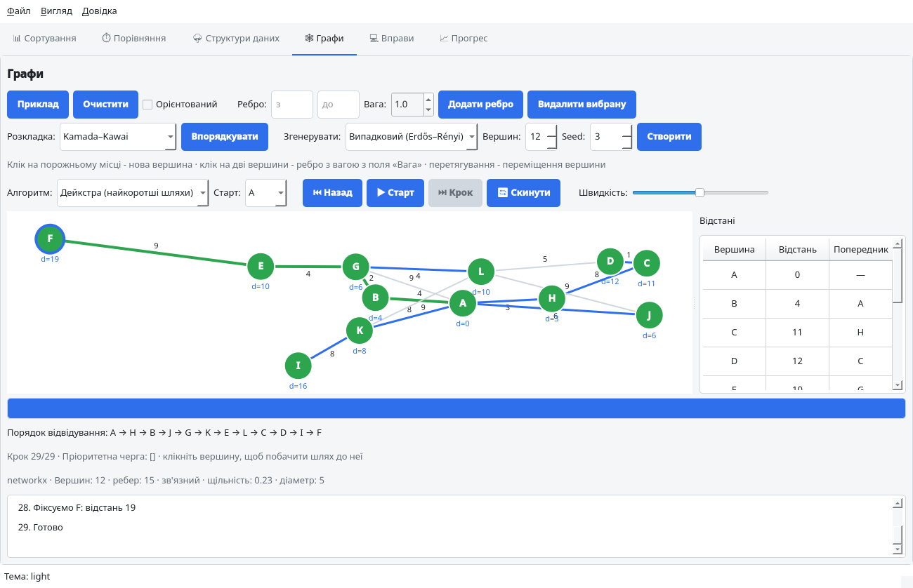
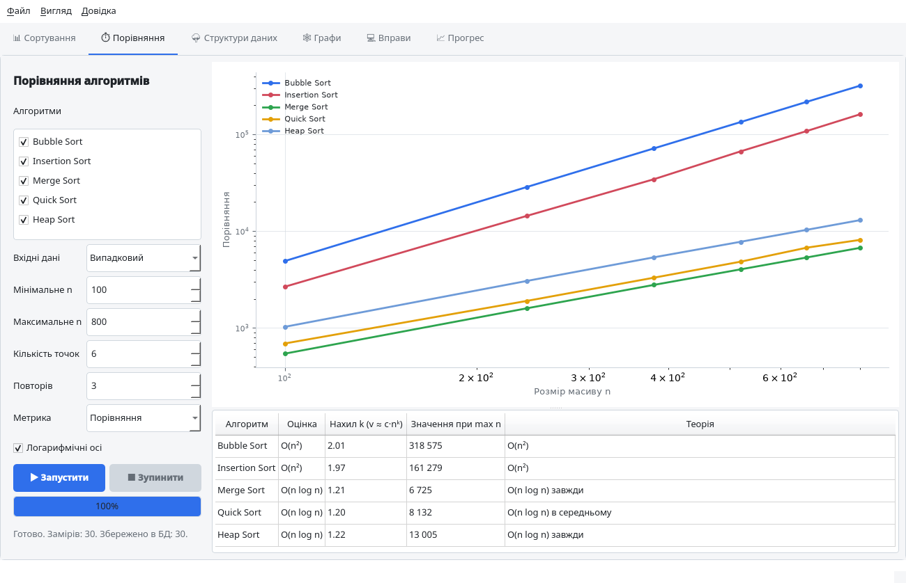
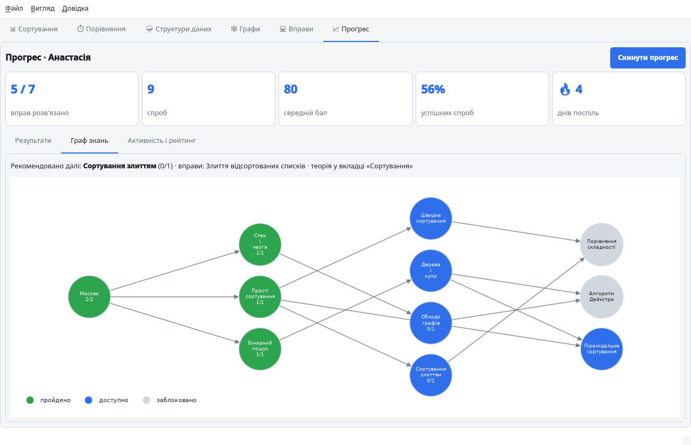
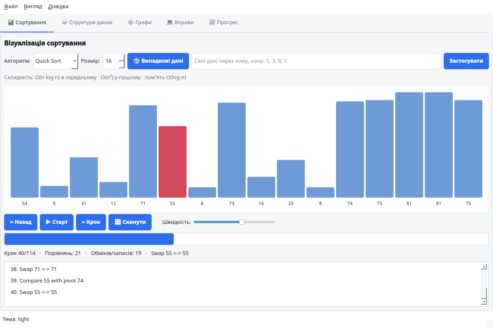
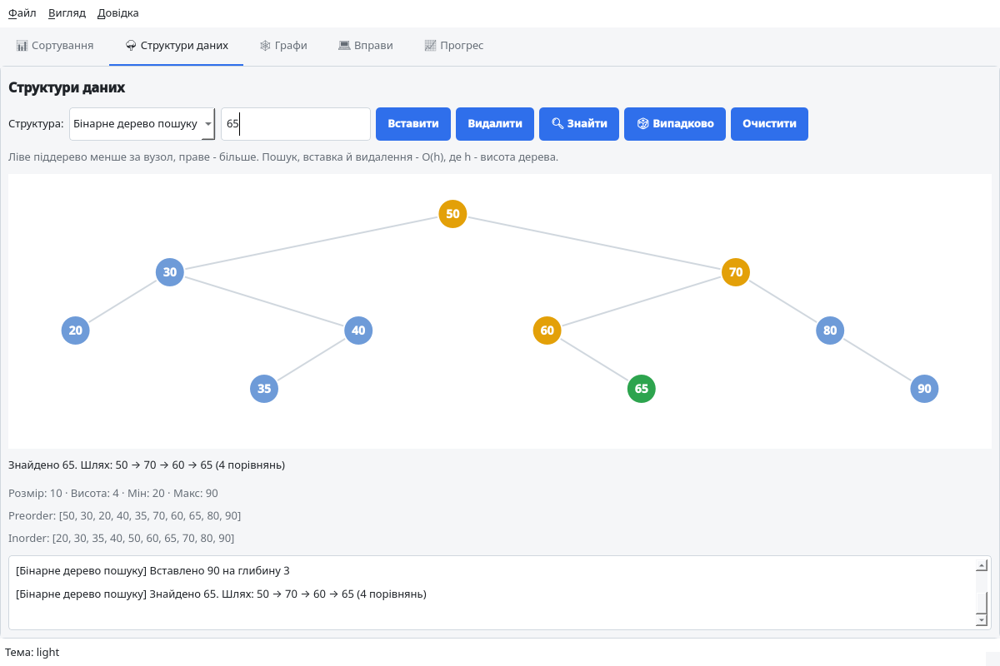
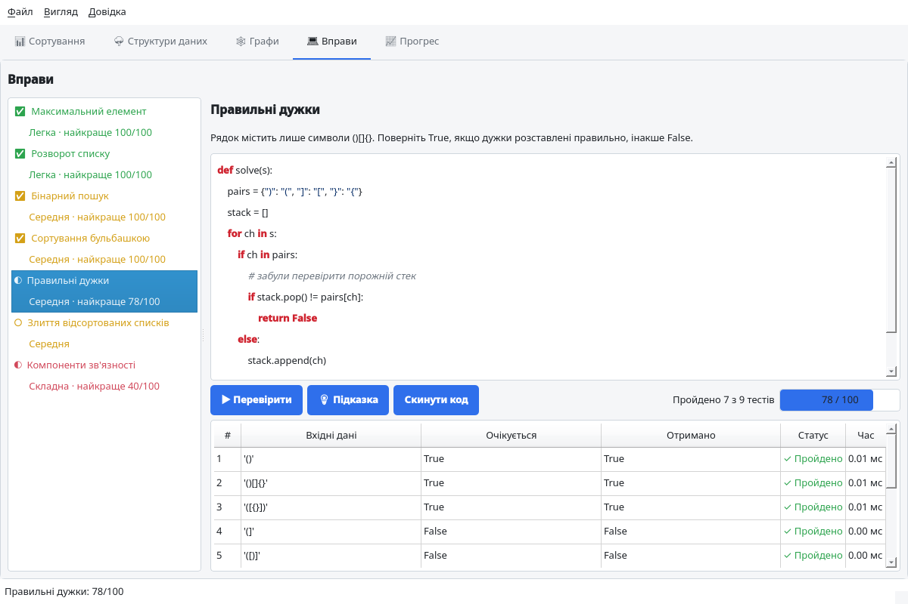
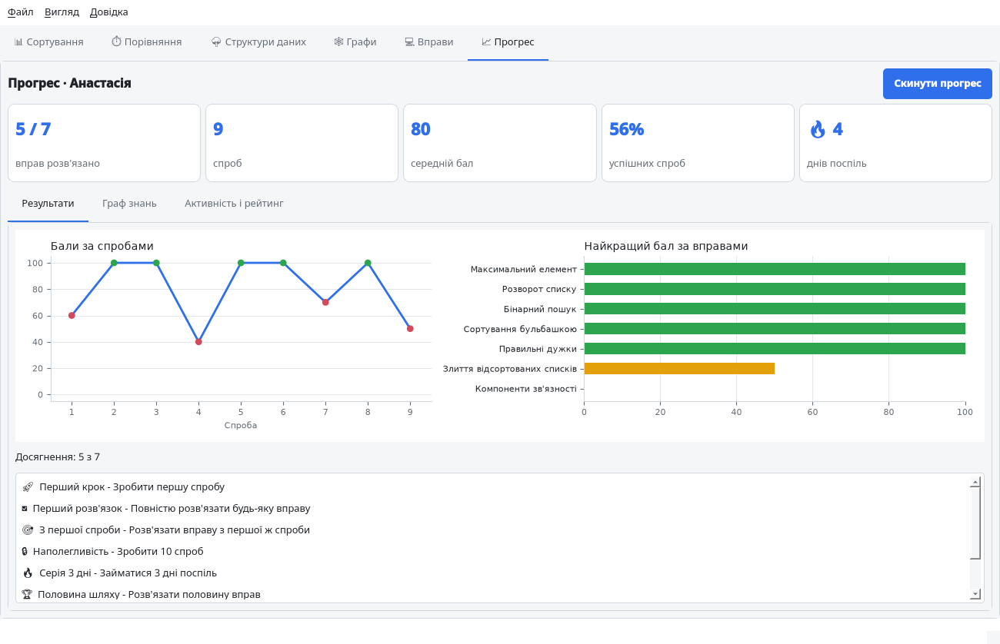
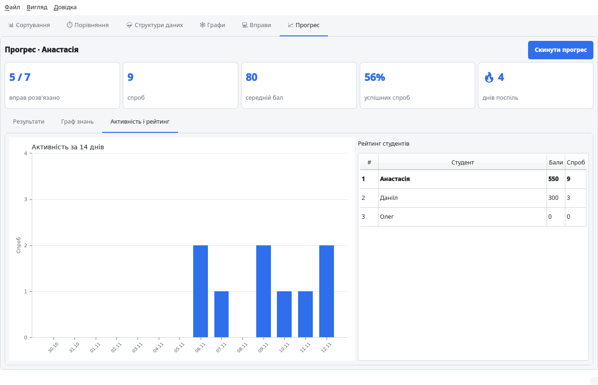
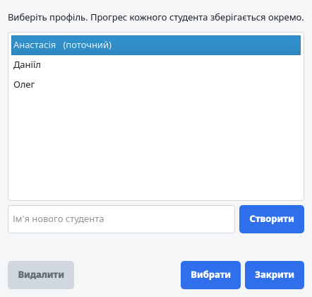

# CodeLearn Studio

Desktop application for learning algorithms and data structures through step-by-step
visualization, interactive data structures, coding exercises with automatic checking,
algorithm benchmarking and progress tracking for several students. Works fully offline.



## Why

Students struggle with algorithms because they can't see how data changes step by step,
don't get immediate feedback on their own code, and can't track their progress.
CodeLearn Studio puts visualization, practice, measurement and progress into one local application.

| Feature | Visualgo | HackerRank | CodeLearn Studio |
|---------|----------|------------|------------------|
| Works offline | No | No | **Yes** |
| Step-by-step visualization | Yes | No | **Yes** |
| Built-in exercises with auto-check | No | Yes | **Yes** |
| Empirical complexity measurement | No | No | **Yes** |
| Progress tracking and study recommendations | No | Yes | **Yes** |
| Open source | No | No | **Yes** |

## Features

The GUI is built with **PyQt5**. Light and dark themes (`Ctrl+T`); window size, theme,
the last tab and the current student are remembered between sessions.

| Tab | What it does |
|-----|--------------|
| 📊 **Sorting** | Bubble, Insertion, Merge, Quick and Heap sort. Play / pause / step forward / step back, speed slider, random or custom input, comparison and swap counters, step log, complexity hints. |
| ⏱ **Comparison** | Benchmarks the sorting algorithms on arrays generated with `numpy` (random, sorted, reversed, nearly sorted, few unique) for a range of sizes with repeated runs. Plots time, comparisons or swaps against *n* (optional log-log axes, error bars) and estimates the complexity of every algorithm from the measurements: the log-log slope and the closest of O(n), O(n log n), O(n²). Runs in a background thread; results are stored in the database. |
| 🌳 **Data structures** | Binary search tree (search path highlighting, traversals, height), min/max heap (tree + array view), hash table (buckets, collisions, resizing, load factor), stack, queue, singly linked list. Insert / delete / find / random fill. |
| 🕸 **Graphs** | Build a graph with the mouse (click to add a vertex, click two vertices to connect them, drag to move) or with the form; weighted and directed graphs. Generate random graphs (Erdős–Rényi, tree, grid, complete) and arrange them with `networkx` layouts (spring, circular, shell, Kamada–Kawai, spectral). Animated **BFS**, **DFS** and **Dijkstra** with a levels / order / distances table and shortest path highlighting; graph metrics (connectivity, components, diameter, density). |
| 💻 **Exercises** | 7 tasks from easy to hard with hints. Code editor with Python syntax highlighting and auto-indent. Solutions run in a separate process with a time limit, so an infinite loop never freezes the app. Results table with expected / actual / time for every test. |
| 📈 **Progress** | Statistics cards (solved exercises, attempts, average score, success rate, day streak). **Results:** score charts and achievements. **Knowledge graph:** course topics with prerequisites, coloured as mastered / available / locked, and a recommendation of what to study next. **Activity and leaderboard:** attempts over the last 14 days and a ranking of all students. |

**Students.** *File → Student…* (`Ctrl+U`) creates, selects and deletes student profiles;
every student has their own progress. The window title shows the current student.

| Comparison | Knowledge graph |
|------------|-----------------|
|  |  |
| **Sorting** | **Data structures** |
|  |  |
| **Exercises** | **Progress** |
|  |  |
| **Activity and leaderboard** | **Students** |
|  |  |

### Non-blocking data structures

`src/data_structures/concurrent/` contains concurrent structures that don't use mutual
exclusion locks in their algorithms:

- **`LockFreeStack`**: Treiber stack.
- **`LockFreeQueue`**: Michael–Scott queue (with "helping" a lagging tail).
- **`SPSCRingBuffer`**: single-producer / single-consumer ring buffer in
  `multiprocessing.shared_memory`, exchanging data between two **processes** using only
  head/tail indices.

CPython does not expose a hardware compare-and-swap instruction, so `AtomicReference`
emulates CAS with a minimal critical section around a single comparison and assignment.
The stack and queue algorithms themselves never hold a lock while working: they prepare
the change and publish it with one CAS, retrying on conflict. On free-threaded Python
(3.13t+) the threads really run in parallel.

```bash
python main.py --concurrency
```

## Libraries

| Library | Where | What for |
|---------|-------|----------|
| **PyQt5** | `src/gui/` | GUI, custom drawing with `QPainter`, background threads |
| **SQLAlchemy** | `src/database/` | ORM models and SQLite storage for students, attempts and benchmark runs |
| **numpy** | `src/core/benchmark.py` | Input generation, statistics of repeated runs, complexity estimation (`polyfit`, `lstsq`) |
| **matplotlib** | `src/gui/panels/dashboard_panel.py`, `benchmark_panel.py` | Progress, activity and benchmark charts; drawing the knowledge graph |
| **networkx** (+ scipy) | `src/algorithms/graphs/nx_adapter.py`, `src/core/knowledge_graph.py` | Graph layouts and generators, graph metrics, knowledge graph, reference algorithms in tests |
| **pytest**, **pytest-cov** | `tests/` | Unit and headless GUI tests, coverage |

What worked well and what didn't with every library is described in
[`LIBRARY_RETROSPECTIVE.md`](LIBRARY_RETROSPECTIVE.md) (in Ukrainian).

### Data storage

Progress is stored in an SQLite database:

- Linux: `~/.local/share/CodeLearn/CodeLearnStudio/codelearn.db`
- Windows: `%APPDATA%\CodeLearn\CodeLearnStudio\codelearn.db`
- macOS: `~/Library/Application Support/CodeLearn/CodeLearnStudio/codelearn.db`

Tables: `students`, `exercise_attempts`, `algorithm_runs`. A `progress.json` file from older
versions found in the same folder is imported automatically on first start and renamed to
`progress.json.imported`.

## How to run

Requirements: Python 3.10+.

```bash
git clone https://github.com/anastasiahopkalo/OOP-university-labs.git
cd OOP-university-labs

python -m venv .venv
source .venv/bin/activate          # Windows: .venv\Scripts\activate
pip install -r requirements.txt

python main.py                     # GUI
python main.py --console           # console demo of the core components
python main.py --concurrency       # non-blocking data structures demo

pytest                             # tests (GUI tests run headless)
pytest --cov=src                   # with coverage
```

PyCharm picks up `requirements.txt` automatically and offers to install the dependencies.

## Project structure

```
├── main.py                          # entry point (GUI / --console / --concurrency)
├── requirements.txt
├── pytest.ini
├── LIBRARY_RETROSPECTIVE.md
├── screenshots/
├── src/
│   ├── core/
│   │   ├── algorithm.py             # Algorithm, SortingAlgorithm, GraphAlgorithm, step records
│   │   ├── data_structure.py        # DataStructure[T] (ABC, Generic)
│   │   ├── exercise.py              # BaseExercise, Exercise, CodeExercise, TestCase
│   │   ├── exercise_catalog.py      # the exercises
│   │   ├── sandbox.py               # runs user code in a separate process with a timeout
│   │   ├── analytics.py             # ProgressTracker (history, best scores, streak)
│   │   ├── achievements.py
│   │   ├── benchmark.py             # numpy input generators, Benchmark, complexity estimation
│   │   └── knowledge_graph.py       # course topics and prerequisites (networkx DiGraph)
│   ├── database/
│   │   ├── models.py                # Student, ExerciseAttempt, AlgorithmRun (SQLAlchemy ORM)
│   │   ├── database.py              # engine, sessions, transactions
│   │   ├── repository.py            # ProgressRepository: JSON and SQL implementations, migration
│   │   └── run_repository.py        # benchmark results
│   ├── algorithms/
│   │   ├── sorting/                 # bubble, insertion, merge, quick, heap
│   │   └── graphs/                  # BFS, DFS, Dijkstra, networkx adapter
│   ├── data_structures/             # linked list, dynamic array, stack, queue,
│   │   │                            # BST, binary heap, hash table, graph
│   │   └── concurrent/              # lock-free stack/queue, SPSC ring buffer
│   └── gui/
│       ├── main_window.py
│       ├── student_dialog.py
│       ├── styles.py                # Theme dataclass + generated QSS
│       ├── step_player.py           # Qt-independent step navigation
│       ├── structure_controllers.py # one controller per data structure
│       ├── panels/                  # one panel per tab
│       └── widgets/                 # canvases, playback bar, code editor
└── tests/                           # 589 tests, ~90% coverage
```

## OOP design

- **Hierarchies:** `Algorithm` → `SortingAlgorithm` → 5 sorts; `Algorithm` → `GraphAlgorithm` →
  BFS / DFS / Dijkstra; `DataStructure[T]` → 10 structures; `BaseExercise` → `Exercise` /
  `CodeExercise`; `ProgressRepository` → `JsonProgressRepository` / `SqlProgressRepository`;
  `InputGenerator` → 5 input kinds; `GraphGenerator` → 4 random graph models;
  `VisualizationCanvas` → `BarCanvas`, `GraphCanvas`, `StructureCanvas` → `TreeCanvas` →
  `BSTCanvas` / `HeapCanvas`, …; `StructureController` → 6 controllers.
- **Template method:** `SortingAlgorithm.execute()` → `_sort()`, `GraphAlgorithm.execute()` → `_run()`.
- **Repository and strategy:** the GUI works with any `ProgressRepository`, the benchmark with any
  `InputGenerator`, the graph tab with any `GraphGenerator`.
- **Adapter:** `nx_adapter.py` converts between our `Graph` and `networkx` graphs.
- **Polymorphism:** the data structures tab works with every structure through the same
  `StructureController` interface; every canvas only implements `draw()`; generics with `TypeVar`.
- **Reuse:** BFS uses our `Queue`, Dijkstra uses our `BinaryHeap` as the priority queue.

## Testing

- Unit tests for all algorithms, data structures, exercises, the sandbox, the database layer,
  the benchmark and the knowledge graph.
- Our BFS, DFS and Dijkstra are cross-checked against `networkx` on random directed and
  undirected graphs.
- Both progress repositories (JSON and SQL) pass the same contract tests.
- GUI tests run headless with the Qt `offscreen` platform; the database is in memory.

## Team

| Area | Daniil Ilchyshyn | Anastasia Hopkalo |
|------|------------------|-------------------|
| Core | Exercises, progress tracker, console entry point, step recording for sorting, numpy benchmark and complexity estimation | `Algorithm` / `SortingAlgorithm` / `DataStructure` base classes, the 5 sorting algorithms, `GraphAlgorithm`, BFS / DFS / Dijkstra, code exercises, sandbox, achievements, knowledge graph |
| Data structures | BST, binary heap, hash table, graph | Linked list, dynamic array, stack, queue, lock-free stack and queue, SPSC ring buffer, networkx adapter, layouts and generators |
| Database | SQLAlchemy models, repositories, JSON → SQLite migration | Student profiles UI, leaderboard |
| GUI | Main window, themes, base canvas, sorting and comparison tabs | Data structures, graphs, exercises and progress tabs |
| Quality | Tests for the core, database and benchmark; retrospective on PyQt5, SQLAlchemy, numpy | Shared fixtures, networkx cross-checks, GUI tests; retrospective on matplotlib, networkx, pytest; README |

## Built with Claude Code

The project was developed with the help of [Claude Code](https://claude.com/claude-code)
using the **Claude Opus 5.5** model: it was used for planning, writing and reviewing code,
tests and documentation. All changes were reviewed, run and committed by the team members.
