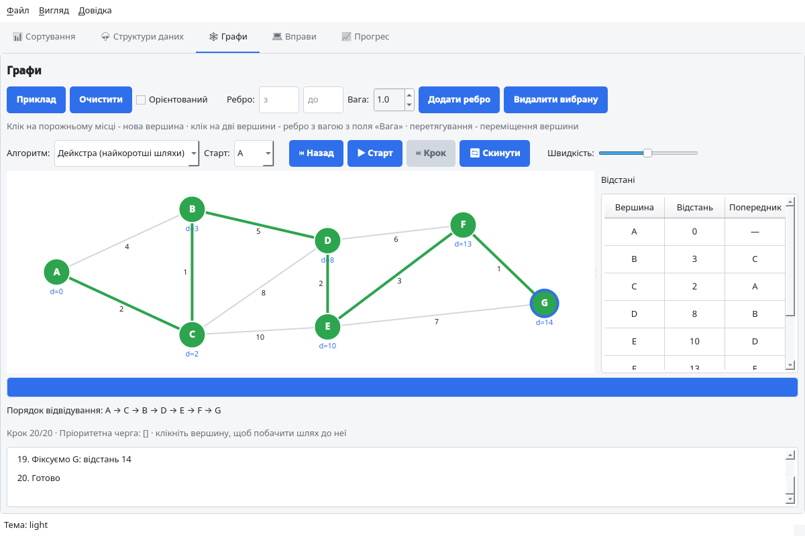
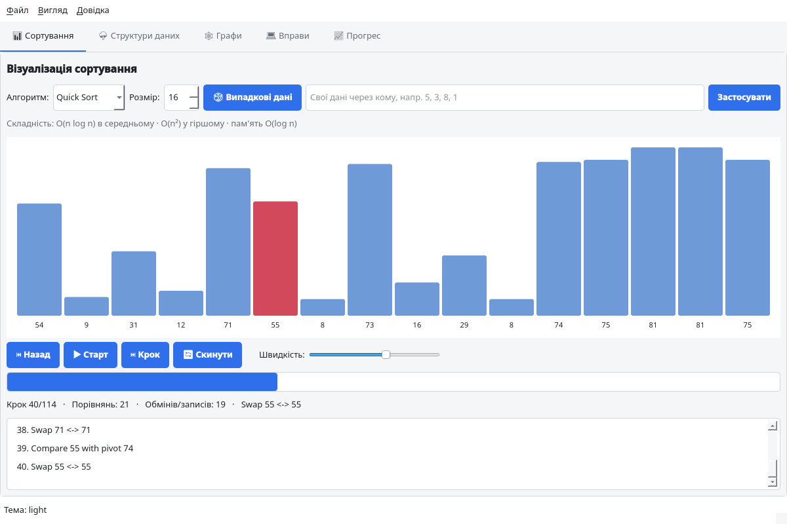
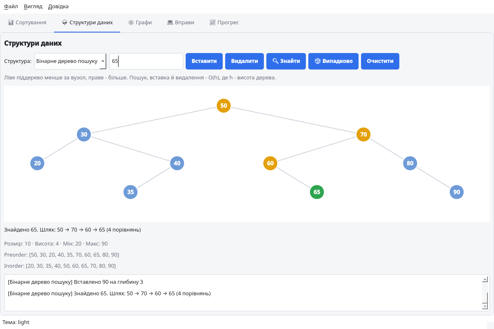
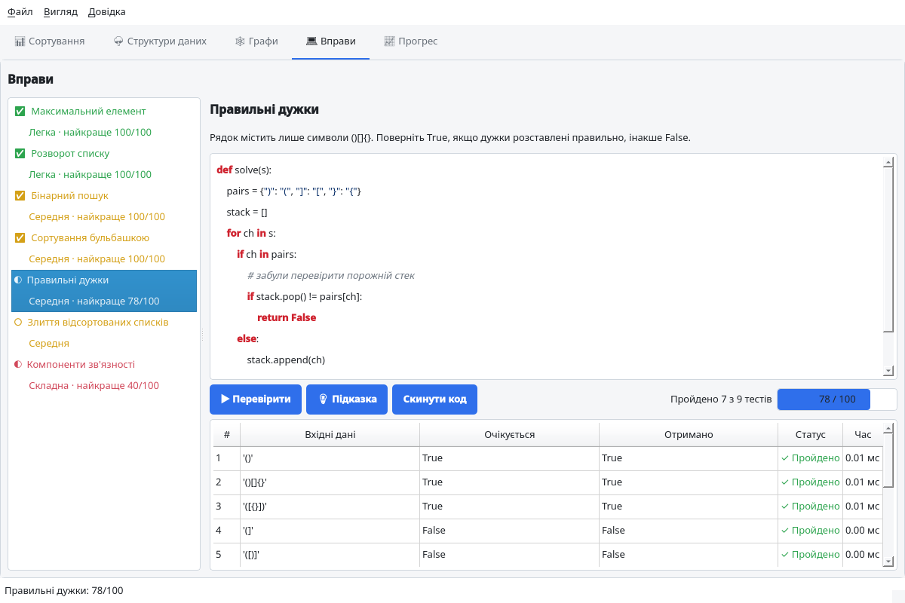
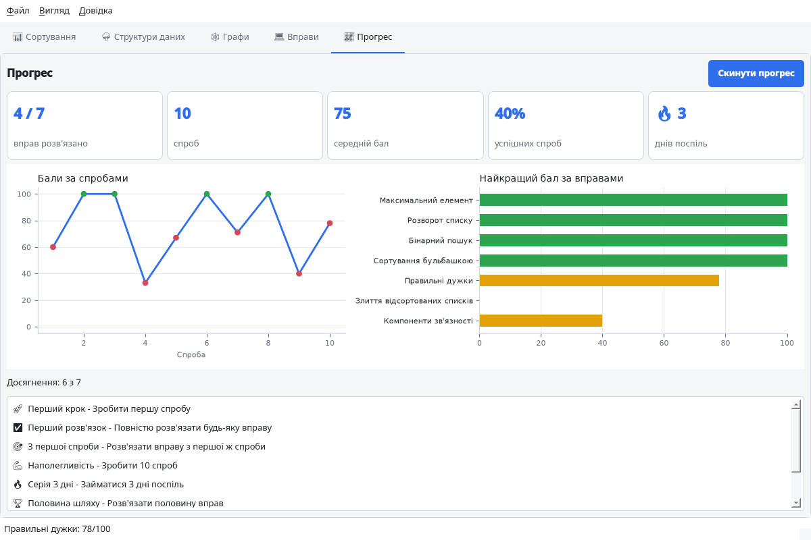

# CodeLearn Studio

Desktop application for learning algorithms and data structures through step-by-step
visualization, interactive data structures, coding exercises with automatic checking,
and progress tracking. Works fully offline.



## Why

Students struggle with algorithms because they can't see how data changes step by step,
don't get immediate feedback on their own code, and can't track their progress.
CodeLearn Studio puts visualization, practice and progress into one local application.

| Feature | Visualgo | HackerRank | CodeLearn Studio |
|---------|----------|------------|------------------|
| Works offline | No | No | **Yes** |
| Step-by-step visualization | Yes | No | **Yes** |
| Built-in exercises with auto-check | No | Yes | **Yes** |
| Progress tracking | No | Yes | **Yes** |
| Open source | No | No | **Yes** |

## Features

The GUI is built with **PyQt5** (custom drawing with `QPainter`, charts with `matplotlib`).
Light and dark themes (`Ctrl+T`); window size, theme and the last tab are remembered.

| Tab | What it does |
|-----|--------------|
| 📊 **Sorting** | Bubble, Insertion, Merge, Quick and Heap sort. Play / pause / step forward / step back, speed slider, random or custom input, comparison and swap counters, step log, complexity hints. |
| 🌳 **Data structures** | Binary search tree (search path highlighting, traversals, height), min/max heap (tree + array view), hash table (buckets, collisions, resizing, load factor), stack, queue, singly linked list. Insert / delete / find / random fill. |
| 🕸 **Graphs** | Build a graph with the mouse (click to add a vertex, click two vertices to connect them, drag to move) or with the form; weighted and directed graphs. Animated **BFS**, **DFS** and **Dijkstra** with a levels / order / distances table and shortest path highlighting. |
| 💻 **Exercises** | 7 tasks from easy to hard with hints. Code editor with Python syntax highlighting and auto-indent. Solutions run in a separate process with a time limit, so an infinite loop never freezes the app. Results table with expected / actual / time for every test. |
| 📈 **Progress** | Solved exercises, attempts, average score, success rate, day streak, `matplotlib` charts and achievements. Progress is saved to a JSON file between sessions. |

| Sorting | Data structures |
|---------|-----------------|
|  |  |
| **Exercises** | **Progress** |
|  |  |

### Non-blocking data structures (bonus)

`src/data_structures/concurrent/` contains concurrent structures that don't use mutual
exclusion locks in their algorithms:

- **`LockFreeStack`**: Treiber stack.
- **`LockFreeQueue`**: Michael–Scott queue (with "helping" a lagging tail).
- **`SPSCRingBuffer`**: single-producer / single-consumer ring buffer in
  `multiprocessing.shared_memory`, exchanging data between two **processes** using only
  head/tail indices.

CPython does not expose a hardware compare-and-swap instruction, so `AtomicReference`
emulates CAS with a minimal critical section around a single comparison and assignment.
The stack and queue algorithms themselves never hold a lock while working: they prepare
the change and publish it with one CAS, retrying on conflict. On free-threaded Python
(3.13t+) the threads really run in parallel.

```bash
python main.py --concurrency
```

## How to run

Requirements: Python 3.10+.

```bash
git clone https://github.com/anastasiahopkalo/OOP-university-labs.git
cd OOP-university-labs

python -m venv .venv
source .venv/bin/activate          # Windows: .venv\Scripts\activate
pip install -r requirements.txt

python main.py                     # GUI
python main.py --console           # console demo of the Lab 1 components
python main.py --concurrency       # non-blocking data structures demo

pytest                             # tests (GUI tests run headless)
pytest --cov=src                   # with coverage
```

PyCharm picks up `requirements.txt` automatically and offers to install the dependencies.

## Project structure

```
├── main.py                          # entry point (GUI / --console / --concurrency)
├── requirements.txt
├── pytest.ini
├── screenshots/
├── src/
│   ├── core/
│   │   ├── algorithm.py             # Algorithm, SortingAlgorithm, GraphAlgorithm, step records
│   │   ├── data_structure.py        # DataStructure[T] (ABC, Generic)
│   │   ├── exercise.py              # BaseExercise, Exercise, CodeExercise, TestCase
│   │   ├── exercise_catalog.py      # the exercises
│   │   ├── sandbox.py               # runs user code in a separate process with a timeout
│   │   ├── analytics.py             # ProgressTracker (history, streak, JSON storage)
│   │   └── achievements.py
│   ├── algorithms/
│   │   ├── sorting/                 # bubble, insertion, merge, quick, heap
│   │   └── graphs/                  # BFS, DFS, Dijkstra
│   ├── data_structures/             # linked list, dynamic array, stack, queue,
│   │   │                            # BST, binary heap, hash table, graph
│   │   └── concurrent/              # lock-free stack/queue, SPSC ring buffer
│   └── gui/
│       ├── main_window.py
│       ├── styles.py                # Theme dataclass + generated QSS
│       ├── step_player.py           # Qt-independent step navigation
│       ├── structure_controllers.py # one controller per data structure
│       ├── panels/                  # one panel per tab
│       └── widgets/                 # canvases, playback bar, code editor
└── tests/
```

## OOP design

- **Hierarchies:** `Algorithm` → `SortingAlgorithm` → 5 sorts; `Algorithm` → `GraphAlgorithm` →
  BFS / DFS / Dijkstra; `DataStructure[T]` → 10 structures; `BaseExercise` → `Exercise` /
  `CodeExercise`; `VisualizationCanvas` → `BarCanvas`, `GraphCanvas`, `StructureCanvas` →
  `TreeCanvas` → `BSTCanvas` / `HeapCanvas`, …; `StructureController` → 6 controllers.
- **Template method:** `SortingAlgorithm.execute()` → `_sort()`, `GraphAlgorithm.execute()` → `_run()`.
- **Polymorphism:** the data structures tab works with every structure through the same
  `StructureController` interface; every canvas only implements `draw()`; generics with `TypeVar`.
- **Reuse:** BFS uses our `Queue`, Dijkstra uses our `BinaryHeap` as the priority queue.

## Team

| Lab 2 | Daniil Ilchyshyn | Anastasia Hopkalo |
|-------|------------------|-------------------|
| Repository | `.gitignore`, `requirements.txt`, tests moved to `tests/` | README, screenshots |
| Core | Step recording for sorting (template method) | `GraphAlgorithm`, BFS / DFS / Dijkstra, code exercises, sandbox, progress tracker, achievements |
| Data structures | BST, binary heap, hash table, graph | Lock-free stack and queue, SPSC ring buffer (bonus) |
| GUI | Main window, themes, base canvas, sorting tab | Data structures, graphs, exercises and progress tabs |

## Lab 3 plan

External libraries: `matplotlib` (already used for the progress charts), `SQLAlchemy`
for storing progress, `networkx` for graph layouts, `pytest` / `pytest-cov`.
